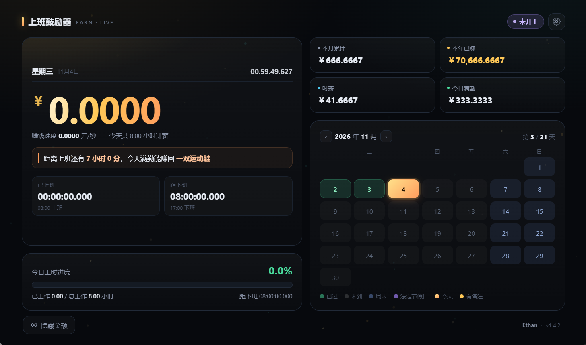

# 上班鼓励器 · Get Paid Live

把月薪拆成每秒都在跳的数字。上班时瞄一眼：今天已经赚了多少，还要熬多久。

Windows 桌面小程序，单个 exe 双击即用，不装 Python、不装运行库。点叉号不退出，缩到右下角托盘继续计时。

[](LICENSE)



## 界面上有什么

- **今日已赚**：四位小数实时累加，午休时段冻结不涨
- **当前赚钱速度**：每秒多少钱
- **工时进度**：百分比 + 进度条 + 已工作 / 总工作小时
- **本月累计、本年已赚、时薪、今日满勤**
- **距发薪倒计时**：填每月几号几点到账，主卡底部一直显示还有多久；碰上周末或法定节假日自动往前挪到最近的工作日
- **当月日历点阵**：每天都画出来，上班日、休息日、节假日、今天各一色；可以左右翻月，点任意日期写一条不超过 100 字的备注（比如「今天加班」「调休」）
- **窗口可缩放**：外壳不再有滚动条占位（滚轮、触控板、PageDown 照常滚），宽了自动两栏、窄到 380 单栏；金额字号跟着卡片宽度走，窗口怎么拉都不会被拆成两行或顶出边
- **鼓励语**：算出「再过多久，某件小东西就到手了」。内置 32 件商品，从 2 元的矿泉水到 1 万元的一次旅行，日薪几百和日薪上千的人都能挑到合适的目标
- **隐藏金额模式**（`H`）：金额全变 `****`，只留工时，工位旁边不怕被看见
- **主题**：默认跟随系统，也可以固定浅色或深色；顶栏设置按钮左边有个月亮/太阳图标，点一下就地切换，不用进设置
- **演示模式**：可以设一个假的"当前时间"，下班后也能看效果
- **到点提醒**：午休开始、午休结束、下班时各弹一条 Windows 通知，带当时赚了多少
- **托盘图标**：关掉窗口程序不退出，鼠标停上去就能看到今天干到哪了
- **开机自动启动**：第一次运行就替你注册好，设置里随时能关
- **自动查新版**：启动时问一次 GitHub，有新版本在顶上提示，点一下去下载；也可以随时点界面右下角的版本号手动查（悬停有提示）
- **设置面板**：工时 / 日历 / 鼓励语 / 外观 / 桌面 / 关于 六个标签页，不用一路往下滚；「关于」页里有 GitHub 仓库地址和 MIT 许可

## 托盘与开机启动

界面上的叉号**不是退出**。点它窗口收进右下角托盘，计时照跑，鼠标悬停就能看到三个数：

```
已上班 3 小时 12 分 · 还有 1 小时 30 分 · ￥123.46
```

没开工、午休、下班后、休息日各有各的说法（「今天下班了 · 今日 ￥356.20」）。开了隐藏金额模式，托盘里的金额也一起变成 `****`。

- **左键点图标** → 回到主界面
- **右键菜单** → 打开主界面 / 开机自动启动（打勾切换）/ 检查更新 / 退出

真的要退出，走右键菜单里的「退出」——这是唯一的正常出口。

## 只开一个

同一时刻只有一份在跑。再双击一次 exe，不会开出第二个窗口，而是把已经在跑的那份叫到前面来（藏在托盘里也会被拉出来）；开着的那个窗口闪一下，就是"已经打开了"。

双击的如果是**更新的版本**，那就反过来：新的一份上前，旧的一份自己退出（走正常退出流程，托盘图标收得干净）。1.4.3 及更早的版本不认这套协议，对它们只能等半秒后直接结束进程；配置写进 SQLite 是单条语句立刻落盘，强杀不会丢已经保存的东西。

判定用的是命名互斥量 + 一块共享内存（版本号、pid、窗口句柄），都在本机内核里，不落文件、不占端口，进程一退内核自动回收。互斥量带 `Local\` 前缀，所以同一台机器上不同用户各开一份互不干扰。

**开机启动**写在当前用户的 `HKCU\...\Run` 里，不需要管理员权限。首次运行程序会自己注册一次；之后你在设置里关掉它就真的不再自动打开了。换了 exe 的存放位置，下次启动会自动把注册表里的路径改成新的。

**数据不全靠界面算**：窗口藏到托盘后，系统会把页面里的定时器节流到一分钟才跑一次。所以程序自己会按最后一次快照把「已赚」和「还剩」往前推，悬停看到的不会是一分钟前的旧数。

## 到点提醒

工作到一半最容易忘记的是时间本身。程序会在三个时点各弹一条 Windows 通知：

| 时点 | 通知内容 |
|---|---|
| 午休开始 | 午休时间到了 · 先去吃饭，上午已经赚了 ￥xx，下午还有 ￥xx |
| 午休结束 | 午休结束 · 回来啦，今天还差 ￥xx 就收工 |
| 下班 | 下班了 · 今天一共 ￥xx，收工，别再惦记工作 |

通知走的是 Windows 自己的通知系统（和托盘气泡同一套），所以会进「通知中心」，也会受**专注助手 / 勿扰模式**和系统通知开关的约束——如果没看到，先看那两处是不是把通知压掉了。

开关在 `设置 → 桌面 → 到点提醒`，默认开着。关掉只是不弹通知，计时和界面一切照旧。开了隐藏金额模式，通知里的金额也会一起变成 `****`，不会在锁屏上把工资泄露出去。

判断是「刚跨过这个时点」才发，所以中途打开程序不会补发过去的提醒；同一天同一种提醒只发一次，重启程序也不会重复。演示模式下不发——那个"现在"是假的。

## 主题

`设置 → 外观 → 界面主题`，三个选项：

- **跟随系统**（默认）：跟 Windows 的「应用模式」走。系统切到夜间模式，界面跟着变深，不用手动换
- **浅色**：白底深字，白天亮环境下看得更舒服
- **深色**：原本的深色金调，数字最扎眼

点一下立刻预览，点「保存」才记住，点「取消」退回原来的。跟工资那些设置一样，只存在本机，不联网。

### 顶栏一键切换

设置按钮左边那个图标就是快捷开关：当前浅色时画月亮（点了变深色），当前深色时画太阳（点了变浅色）。点下去立刻生效，并且直接存进数据库，下次启动就是切完的那个，不需要再进设置点保存。

处在「跟随系统」时按**此刻实际看到的**明暗切到对面——深色系统下点一下就会变浅色，不会出现「点了没反应」。切过一次之后就固定为你选的那个，不再跟随系统；想回到跟随系统，还是去 `设置 → 外观`。

> 主题在第一帧之前就定好了（放在 `<head>` 里直接读 localStorage），所以深色用户启动时不会先闪一下白底。

## 设置面板

按主题分成五页，标题和标签栏钉在顶上，只有当前页的内容滚动：

| 页 | 放什么 |
|---|---|
| **工时** | 月薪、上下班时间、午休、每周上班的日子 |
| **日历** | 法定节假日、调休补班日 |
| **鼓励语** | 商品表，一行一个「名称,价格」 |
| **外观** | 界面主题、演示模式 |
| **桌面** | 开机自动启动、到点提醒、启动时检查更新 |

快捷键 `C` 打开，每次从第一页开始。哪一页填错了，点保存会自动跳到那一页并滚到出错的位置，不用自己找。

## 下载

到 [**Releases**](https://github.com/yoea/get-paid-live/releases) 下载 `GetPaidLive-v1.4.5.exe`，双击运行。

单文件约 20 MB，不需要安装 Python、浏览器或任何运行库。文件名和右键「属性 → 详细信息」里都带版本号，方便确认拿到的是哪一版。

exe 不是手工传上去的：每个 Release 都由 GitHub Actions 在干净的 Windows 环境里现编译，从源码到产物这条链路可查（见下面的[打包与发布](#打包与发布)）。

> 文件名是英文的：GitHub Release 的附件名只保留 ASCII 字母数字和 `._-`，中文会被静默删掉（`上班鼓励器-v1.4.5.exe` 会变成 `-v1.4.5.exe`）。窗口标题和文件属性里仍然是中文的「上班鼓励器」。

## 打包与发布

打包全部交给 GitHub Actions，本地不需要装任何东西。工作流文件是 [`.github/workflows/build.yml`](.github/workflows/build.yml)。

### 发一个正式版本

版本号只有一个来源：`version.py` 里的 `VERSION`。改它，exe 文件名、文件属性、界面右下角的签名核对、Release 标签、查更新时的比对基准全都跟着走。

```bash
# 1. 改 version.py：VERSION = "1.4.5"
# 2. 顺手改 上班鼓励器.html 里的 <span id="verNum">v1.4.5</span>
# 3. 在 .github/release-notes.md 里加一段「## v1.4.5」——记住插在最上面，
#    那个文件是 Release 正文，最新的必须排第一，往下才是历史版本
# 4. 提交
git add -A && git commit -m "v1.4.5"
git push

# 5. 打同名标签推上去，剩下的交给 CI
git tag -a v1.4.5 -m "v1.4.5"
git push origin v1.4.5
```

推完标签后大概 1–2 分钟，[Releases](https://github.com/yoea/get-paid-live/releases) 上就多一个带 exe 的版本。

### CI 做了什么

| 步骤 | 说明 |
|---|---|
| 检出代码 | `windows-latest` 干净环境 |
| 安装 Python | 3.12，`cache: pip` 按 `requirements.txt` 缓存依赖 |
| 装依赖 | pywebview（框架）+ pyinstaller（打包器），只装在构建机上 |
| 校验版本号 | 标签 `v1.4.5` 必须等于 `version.py` 里的 `VERSION`，不一致直接失败 |
| 打包 | 跑 `python build.py`，产出单文件 exe |
| 校验产物 | 文件名里必须含版本号、体积必须大于 5 MB，否则判定打包缺东西 |
| 存构建产物 | 上传到 Actions 的 Artifacts，保留 7 天 |
| 发 Release | 用 `gh release` 创建版本并附上 exe，正文整段取自 `.github/release-notes.md` |

**版本号对不上就让 CI 失败**，是这个工作流最有用的一条：避免出现「标签写 1.4.6、exe 里却是 1.4.5」这种发出去才发现的问题。

Release 正文的排序也是约定：`.github/release-notes.md` 里最上面永远是最新版本，新段落往下压一层旧的，长期不变的功能说明固定在最后一节。CI 原样使用，不做任何重排。

### 只想试打包，不想发版

到 Actions 页面选 **Build exe → Run workflow**，手动触发一次。这种运行只产出 Artifacts，不会创建 Release——适合验证改动能不能打包成功。Artifacts 需要在登录状态下下载，7 天后自动清理。

### 本地打包（可选）

CI 挂了或者想离线验证，本地也能打，约 24 秒：

```bash
打包exe.bat
```

生成 `dist\GetPaidLive-v1.4.5.exe`。第一次运行会联网装 pywebview / pystray / pyinstaller，装在项目内的 `.venv-build`，不动你的全局 Python。

或者手动执行等价的三条：

```bash
python -m venv .venv-build
.venv-build\Scripts\python.exe -m pip install -r requirements.txt
.venv-build\Scripts\python.exe build.py
```

### 踩过的坑

这几个都写在代码注释里，也记一下免得重犯：

- **Release 附件名只能是 ASCII。** 平台会静默删掉文件名里的非 ASCII 字符，任何上传方式（Softprops action、`gh release upload`、网页拖拽）都一样。所以产物名固定为 `GetPaidLive-v{版本}.exe`，中文名只留在窗口标题和文件属性 `ProductName` 里。
- **Windows runner 的控制台默认是 cp1252。** `build.py` 打印中文会当场 `UnicodeEncodeError`，所以脚本开头强制 `sys.stdout.reconfigure(encoding="utf-8")`，工作流里再补 `PYTHONIOENCODING` / `PYTHONUTF8` 两个环境变量透传给 PyInstaller 子进程。
- **`setup-python` 的 `cache: pip` 找不到依赖清单会直接失败**，连 Python 都装不上。所以仓库里必须有 `requirements.txt`，并用 `cache-dependency-path` 指向它。
- **用 `gh release` 而不是 marketplace 的发布 action。** 两者剥中文名的行为一模一样，`gh` 少一层封装，日志更直接、出错时好查。
- **打包前清理 `dist` 里的旧 exe**（`build.py` 的 `clean_old_exe()`），否则本地多次打包会混进旧版本的包。
- **pywebview 的 `closing` 事件返回值是反的。** handler 返回 `False` 才表示「不许关」——`Event.set()` 只在有 handler 返回 `False` 时才返回 `True`，winforms 拿到 `True` 就设 `args.Cancel = True`。按直觉写成「返回 True 取消关闭」的话，叉号会直接退出，而托盘的「退出」反而关不掉。
- **JS 调 Python 接口时别传 `undefined`。** `api.foo(undefined)` 会被当成一个实参，零参方法直接 `TypeError: takes 1 positional argument but 2 were given`。所以 `desk.call()` 里按 `arg === undefined` 分成两条调用路径。
- **托盘图标必须用 Pillow。** pystray 在 Windows 上会把图标对象存成临时 ICO 再 `LoadImage`，绕不开 PIL；这也是 1.3 版体积从 13 MB 涨到 20 MB 的原因。

## 为什么是 20 MB

界面交给 Windows 自带的 WebView2 渲染，不打包浏览器内核。Electron 这类方案最少 100 MB 起，这个方案只带 Python 运行时、一份 HTML，以及画托盘图标用的 Pillow——1.3 版加托盘时带进来的，约占 7 MB。

启动前会检测 WebView2（Win11 自带，正常更新的 Win10 也有），真的缺了会弹出提示并给出官方下载地址，而不是双击没反应。

## 数据只在本地，只查一次版本号

**无账号、不上传任何东西。** 唯一的对外请求是启动时向 GitHub 查一次最新版本号。

- 工资、作息、日历备注和桌面选项（是否开机启动、是否查更新、是否到点提醒）都存在 `%LOCALAPPDATA%\ShangBanGuLiQi` 的一个 **SQLite 数据库**里（`store.db`）
- 从 1.3.x 升上来会自动把旧数据（localStorage 和 `desktop.json`）迁进去，旧文件改名 `.bak` 保留
- 开机启动项在 `HKCU\Software\Microsoft\Windows\CurrentVersion\Run`，关掉开关就删掉
- 覆盖安装新版 exe，之前填的工资、作息和日历备注不会丢
- 想彻底清除，删掉那个目录，再在设置里关掉开机启动

那个版本检查只请求 `api.github.com/repos/yoea/get-paid-live/releases/latest`，拿回一个标签号跟自己的版本比一下，不带任何本机信息。不想要就在设置里关掉「启动时检查更新」，关掉之后程序一次网络都不碰。

技术细节：程序启动时会在 `127.0.0.1` 上起一个本地静态服务来托管界面。这不是网络服务——WebView2 在 `file://` 协议下拒绝使用 localStorage（判定为不安全），只能走本地 http。它只监听回环地址，外部访问不到。

## 算法口径

| 项目 | 口径 |
|---|---|
| 日薪 | 月薪 ÷ **当月实际工作日数**（扣掉周末和节假日，加上调休补班日） |
| 时薪 | 日薪 ÷ 每日工时（午休时段不计入） |
| 今日已赚 | 已工作时长 × 时薪，午休期间冻结 |
| 本月累计 | 本月已过的工作日按满勤补算 + 今日已赚（只算已赚到的，不预支未来） |
| 本年已赚 | 1 月至上月满勤 + 本月累计 |
| 下一个发薪日 | 每月「X 号 HH:MM」，落在非工作日就往前挪到最近的工作日（可以跨月，最多退 20 天）；当月没有这一天（31 号遇上 30 天的月份）按当月末算；当天已过点则取下月 |

所以每日金额会随当月工作日数浮动：同样 8000 月薪，21 个工作日的月份日薪 380.95，23 个工作日的月份日薪 347.83。这比「月薪 ÷ 21.75」更贴近你当月的实际付出。

**鼓励语怎么挑**：从商品表里筛出「今天还没赚到、但下班前赚得到」的，选最贵的一件，算出还差多久；已经赚到的自动跳过。

## 首次使用

打开后会先让你填：月薪、上下班时间、午休时段、哪几天上班、每月几号几点发薪。
填完才进主界面开始计时——不会拿一份写死的默认值糊弄你。

月薪建议填**到手数**，这样算出来的钱才是你真正能花的。

第一次运行时，程序会顺手把开机启动注册好（下次开机它自己会起来）。不想这样，进设置把「开机自动启动」关掉就行，关掉之后不会再自己打开。

## 项目结构

```
desktop.py                    桌面外壳：窗口、托盘、开机启动、到点通知、查更新
上班鼓励器.html                界面与全部逻辑
version.py                    版本号（唯一来源，打包和查更新都读它）
build.py                      打包脚本，版本号之外的打包参数在这里
打包exe.bat                   一键打包（本地用，CI 不用它）
requirements.txt              打包依赖（只装在构建机，不随 exe 分发）
app.ico                       应用图标（窗口和托盘共用）
LICENSE                       MIT 许可证
.github/workflows/build.yml   CI：推 v* 标签自动构建并发 Release
.github/release-notes.md      Release 正文模板
assets/screenshot.png         README 用的界面截图
```

## 已知限制

- **内置 2026–2027 年节假日安排**（2027 年按国务院办公厅通知预置）。两年之后请自行在设置里补充，或者干脆留空——留空不会报错，只会把节假日当工作日算。调休补班日因各公司排班不同，默认留空，需要你自己填。
- 统计只覆盖**当月和当年**，没有历史账本，也不构成任何财务建议。
- 只支持 **Windows 10 及以上**。开机启动、托盘都是 Windows 专属实现，没有跨平台版本。
- 托盘文案精确到分钟，按最后一次界面快照最多外推 4 小时。电脑睡眠跨过午休时可能要打开界面让它重新同步一次。
- 到点提醒用的是系统通知，**专注助手 / 勿扰模式**会把它们压下去；系统里关掉「上班鼓励器」的通知权限也一样。
- 自动查更新需要能访问 `api.github.com`。连不上就静默跳过，不影响使用，也可以自己去看 Releases。

## 许可

[MIT License](LICENSE) © 2026 Ethan

随便用、随便改、随便分发，包括商用，保留版权声明即可。软件按「原样」提供，不附带任何担保。

---

作者 **Ethan** · v1.4.5 · MIT
